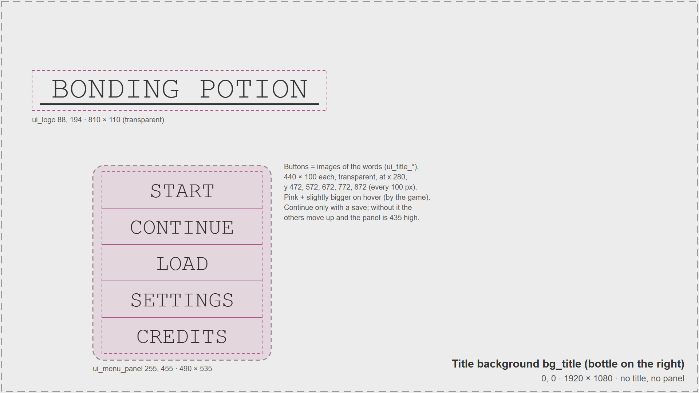
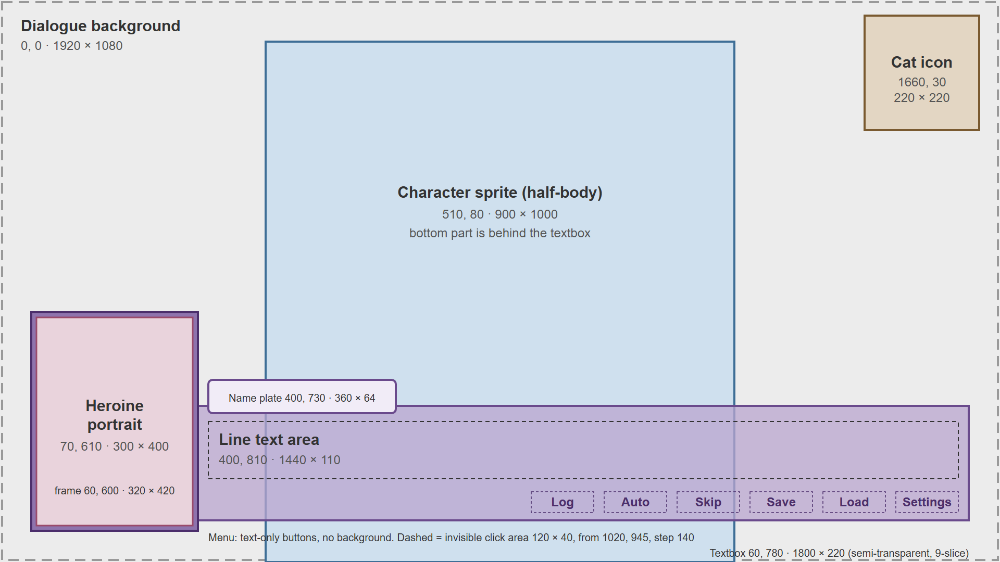
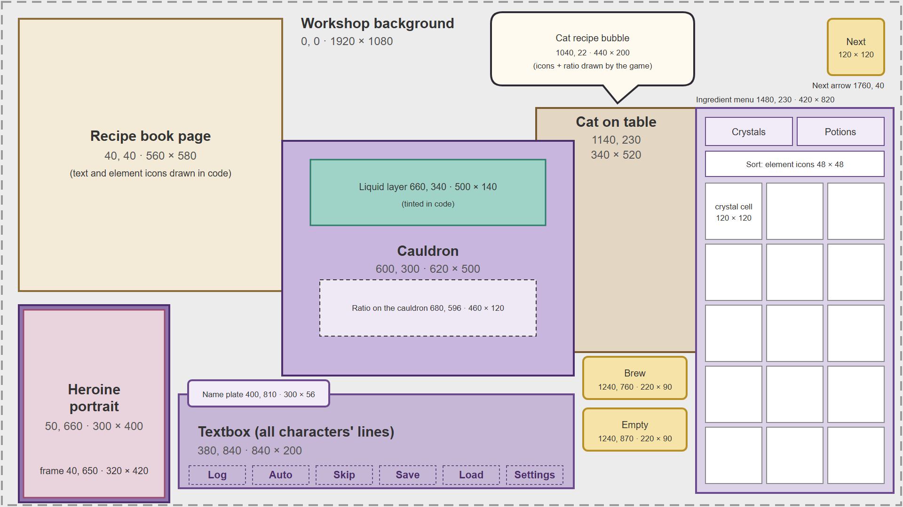
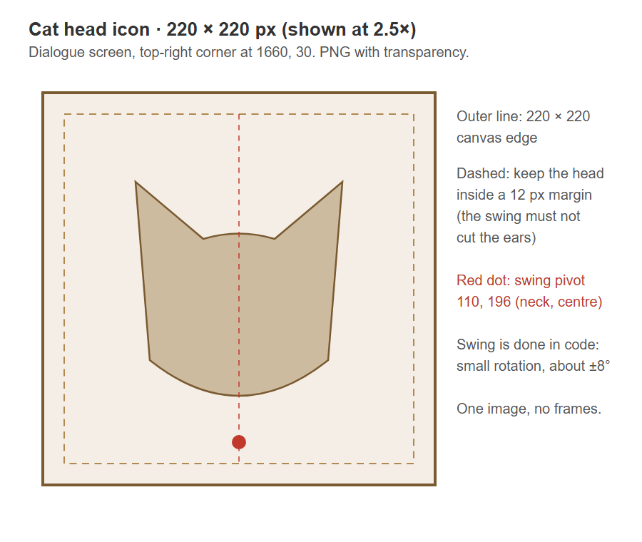
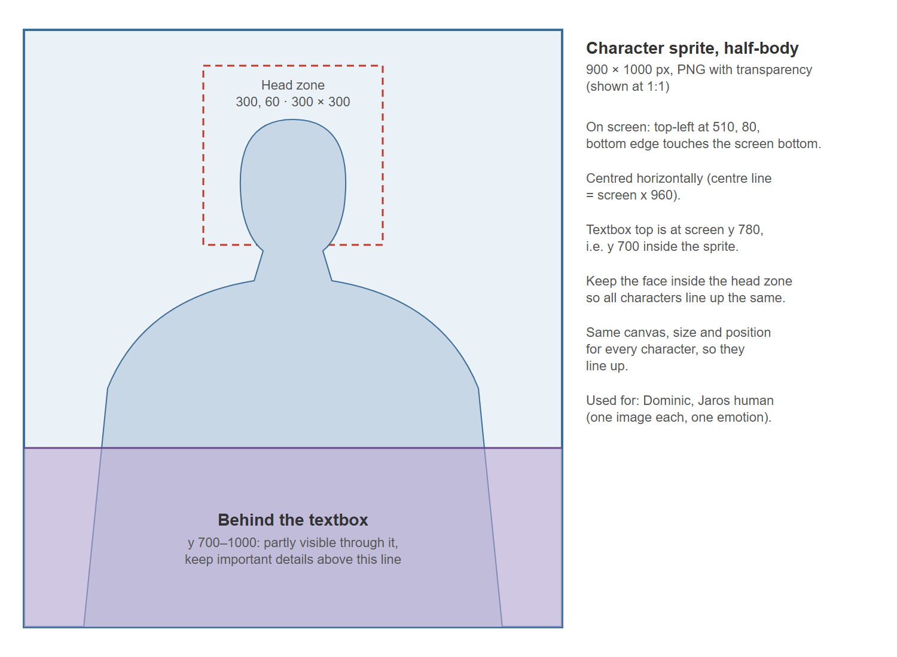

# Bonding Potion — Art List

## Как читать позиции (для художника)

**Позиция** — это координаты **x, y левого верхнего угла** картинки на экране размером **1920 × 1080** пикселей. Точка **0, 0** — левый верхний угол экрана. **x** отсчитывается от левого края вправо, **y** — от верхнего края вниз.

**Размер** — это **ширина × высота** картинки в пикселях. Файл нужно экспортировать ровно этого размера.

Пример: «Позиция 1660, 30 · Размер 220 × 220» значит, что картинка начинается в 1660 px от левого края и в 30 px от верхнего края экрана. Её правый нижний угол будет в точке 1880, 250.

Если координаты указаны **внутри картинки** (например, «зона головы» у спрайта или точка вращения иконки кота), они считаются от левого верхнего угла самой картинки, а не экрана. В описании это всегда отмечено.

Все позиции наглядно показаны на схемах в папке [layouts/](layouts/) и в документе [Screen Layouts](Screen%20Layouts.md).

---

| | |
|---|---|
| **Version** | 1.0 |
| **Date** | 14 November 2026 |
| **Based on** | [Game Design Document](Game%20Design%20Document.md), [Technical Design Document](Technical%20Design%20Document.md), [Screen Layouts](Screen%20Layouts.md) |

## 1. General requirements

| Requirement | Value |
|---|---|
| Screen | 1920 × 1080 (landscape). The game scales everything down for smaller screens, so draw at this size. |
| Style | Hand-drawn 2D; expressive characters with simple silhouettes. The colour palette is up to the artist; colours in the layout drawings are not final. |
| Element colours | Fire = yellow, Water = blue, Earth = green, Air = purple. Exact shades are the artist's choice (the game takes them from a config file). |
| Element shapes | Fire = triangle, Water = circle, Earth = square, Air = rhombus. |
| Format | **Backgrounds and full-screen illustrations: JPG**, quality ~85, no transparency. **Everything else: PNG with transparency** (32-bit RGBA). Colour space sRGB. |
| Size | Export each file **exactly** at the listed size. |
| File names | Exactly as listed: lowercase, underscores, no spaces. Saving a file with the same name into the same folder replaces the temporary image in the game. |
| Folder | `assets/images/<folder>/` as listed. |
| Replacing files | Easiest: the **Art tab of the content editor** (`editor.html`, Chrome or Edge). Drag the finished image onto its card; the editor checks size and format, offers to resize, and saves it under the right name. By hand also works: same name, same size, same folder. |
| Text | **Don't paint text** on buttons, the recipe page, panels or the textbox: the game writes it. The logo is the only image with lettering. |
| Characters | Each human character (Heroine, Chad, Jaros in human form) has **one image with one emotion**: no expression variants. Chad and Jaros use the same canvas, size and framing, so they line up. |
| Stretchable frames (9-slice) | Some UI frames are stretched by the game. Their corners (the "slice" width given in the table) are never stretched; the edges stretch in one direction; the centre stretches in both. Keep corner decoration inside the slice area and keep edges and centre plain enough to stretch. |
| File size | Compress PNGs (e.g. TinyPNG). Total art should stay under ~25 MB. |

**Priority:** *Must* = needed for the first playable version. *Should* = needed for the planned features. *Could* = nice to have. Every file already exists as a temporary image, so the game works whatever is finished.

---

## 2. Backgrounds — `assets/images/backgrounds/`

| File | Size | Position | Priority | Notes |
|---|---|---|---|---|
| `bg_title.jpg` | 1920 × 1080 | 0, 0 | Must | Title screen. A picture on the **right** side (for example the Heroine and the cat). The logo (100, 100 · 800 × 320) and up to five buttons (300, 460–1020 · 400 wide) sit on the **left**, so keep the left side calm. |
| `bg_shop.jpg` | 1920 × 1080 | 0, 0 | Must | Shop interior: all dialogue scenes and endings. The bottom area (y 780–1000) is under the semi-transparent textbox; the centre (x 510–1410) is behind character sprites; the top-right corner (1660, 30 · 220 × 220) has the cat icon. |
| `bg_workshop.jpg` | 1920 × 1080 | 0, 0 | Must | Potion screen: the workshop table, where the cauldron and the cat stand. The table surface should be roughly under the cauldron (600–1220 × 300–800) and the cat (1140–1480 × 230–750). Most of the screen is covered by UI; the background can be fairly simple. |

## 3. Ending illustrations — `assets/images/endings/`

| File | Size | Position | Priority | Notes |
|---|---|---|---|---|
| `ending_romance.jpg` | 1920 × 1080 | 0, 0 | Must | Jaros, now human, and the Heroine together. Shown on the ending card. |
| `ending_friendship.jpg` | 1920 × 1080 | 0, 0 | Must | Jaros, human, as a friend; the Heroine free of Chad. |
| `ending_bad.jpg` | 1920 × 1080 | 0, 0 | Must | Chad obsessed with the Heroine; it should feel wrong, a nightmare. |

The ending card writes the ending's name and "Ending X of 3" over the illustration in the centre, plus a button at 760, 880 · 400 × 100. Keep the central area readable.

## 4. Characters — `assets/images/characters/`

### 4.1 Heroine portrait

| File | Size | Position | Priority | Notes |
|---|---|---|---|---|
| `heroine.png` | 300 × 400 | Dialogue: 70, 610 · Potion screen: 50, 660 | Must | Head and shoulders, facing slightly right (toward the textbox). One image for the whole game, so a calm, friendly look that suits every scene works best. |

The portrait sits inside the frame `ui_portrait_frame` (section 7). The frame covers the outer 10 px, so keep the face well inside.

### 4.2 Half-body character sprites

All sprites: **900 × 1000**, PNG with transparency, **position 510, 80** (centred, bottom edge at the bottom of the screen). See [layouts/character_sprite.png](layouts/character_sprite.png).

- **Head zone** (inside the image): 300, 60 · 300 × 300. Keep the face here so all characters line up.
- **Behind the textbox** (inside the image): y 700–1000. It shows through the semi-transparent textbox; keep important details (hands, props) above y 700.

| File | Priority | Notes |
|---|---|---|
| `chad.png` | Must | Handsome and charming on the surface, with a hint of arrogance. One image for every scene, including the bad ending. |
| `jaros_human.png` | Must | The cat's human form, a wizard freed from the curse (romance and friendship endings). Should feel like the same personality as the cat (for example a hint of black-cat features in hair or clothes). |

### 4.3 Cat (Jaros)

| File | Size | Position | Priority | Notes |
|---|---|---|---|---|
| `cat_icon.png` | 220 × 220 | 1660, 30 (dialogue screen) | Must | Black cat's head. Keep it inside a 12 px margin. The game rocks it ±8° around the point **110, 196 inside the image** (the neck) while the cat speaks, so the ears must not touch the edges. See [layouts/cat_head_icon.png](layouts/cat_head_icon.png). |
| `cat_table.png` | 340 × 520 | 1140, 230 (potion screen) | Must | One pose: the black cat sitting on the table behind the cauldron. The cauldron covers the lower-left part of the image (roughly x 0–80, y 70–520 inside the image), so keep the cat's face and body toward the right and top. Not shown in potion 6. The player can click the cat. |

## 5. Potion screen objects — `assets/images/potion/`

| File | Size | Position | Priority | Notes |
|---|---|---|---|---|
| `cauldron.png` | 620 × 500 | 600, 300 | Must | Front view, opening at the top. The game draws the liquid layer over the opening and the element counter on the front (inside the image: 100, 320 · 420 × 70). Keep that front area fairly plain so icons and numbers read well. |
| `cauldron_liquid.png` | 500 × 140 | 660, 340 | Must | The liquid surface seen in the opening. **Light grey / white**: the game tints it to the mix colour. Can have bubbles and highlights in lighter grey. |
| `recipe_page.png` | 560 × 580 | 40, 40 | Must | An open book page or parchment, **without text**. The game writes the potion name (top, ~80 px tall area), a row of element icons with the ratio numbers under them, e.g. 2 : 3 : 2 (middle, around y 240–360 inside the page) and a flavour line (bottom). Keep a margin of ~40 px around the edges for decoration. |

## 6. Crystals, elements and bottles

### 6.1 Crystals — `assets/images/crystals/`

All crystals: **128 × 128**, PNG with transparency. Shown in the ingredient menu cells (120 × 120, slightly scaled down) and dragged to the cauldron. Colours follow the elements inside (yellow = fire, blue = water, green = earth, purple = air). Small crystals hold 10 units, large ones 30; clusters hold 2 different elements, the prism 3. Where one element is stronger (e.g. Marsh Jade: 10 water + 20 earth), that colour should dominate. They should be easy to tell apart at a glance.

| File | Elements | Look | Priority |
|---|---|---|---|
| `crystal_ember_shard.png` | Fire 10 | Small yellow triangular shard | Must |
| `crystal_root_stone.png` | Earth 10 | Small green cube | Must |
| `crystal_lava_garnet.png` | Fire 10, Earth 10 | Yellow and green cluster | Must |
| `crystal_tide_pearl.png` | Water 10 | Small blue round crystal | Must |
| `crystal_wisp_quartz.png` | Air 10 | Small purple rhombus | Must |
| `crystal_storm_opal.png` | Water 10, Air 10 | Blue and purple cluster | Must |
| `crystal_deep_sapphire.png` | Water 30 | Large blue crystal | Must |
| `crystal_marsh_jade.png` | Water 10, Earth 20 | Green cluster with a smaller blue part | Must |
| `crystal_sun_citrine.png` | Fire 20, Air 10 | Yellow cluster with a smaller purple part | Must |
| `crystal_blaze_ruby.png` | Fire 30 | Large yellow crystal | Must |
| `crystal_sky_amethyst.png` | Air 30 | Large purple crystal | Must |
| `crystal_mountain_amber.png` | Earth 30 | Large green crystal | Must |
| `crystal_dusk_prism.png` | Fire 20, Earth 10, Air 10 | Three-coloured prism, mostly yellow, with green and purple | Must |

### 6.2 Element icons — `assets/images/elements/`

All: **64 × 64**, PNG with transparency, a **simple one-colour figure**. Used on the recipe page and the element counter at 64 × 64, and in the sort row at 48 × 48 (scaled down by the game).

| File | Shape and colour | Priority |
|---|---|---|
| `element_fire.png` | Yellow triangle | Must |
| `element_water.png` | Blue circle | Must |
| `element_earth.png` | Green square | Must |
| `element_air.png` | Purple rhombus | Must |

### 6.3 Potion bottles — `assets/images/bottles/`

| File | Size | Priority | Notes |
|---|---|---|---|
| `bottle_fun.png` | 128 × 128 | Must | Liquid in the colours of its elements (yellow + green). Shown in the Potions tab and on success. |
| `bottle_courage.png` | 128 × 128 | Must | Blue + purple. |
| `bottle_trust.png` | 128 × 128 | Must | Blue + green. |
| `bottle_hope.png` | 128 × 128 | Must | Yellow + purple + blue. |
| `bottle_confidence.png` | 128 × 128 | Must | Green + purple + yellow. |
| `bottle_gratitude.png` | 128 × 128 | Must | All four colours. |
| `bottle_love.png` | 256 × 256 | Must | The love potion, shown large in the centre of the screen (832, 412) when it's brewed. Special and magical. |

The six bottles should look like one set (similar shape family, different details) so each is recognisable.

## 7. Interface — `assets/images/ui/`

### 7.1 Fixed-size images

| File | Size | Position | States | Priority | Notes |
|---|---|---|---|---|---|
| `ui_logo.png` | 800 × 320 | 100, 100 (title) | — | Must | "Bonding Potion" lettering. The only image with text. |
| `ui_portrait_frame.png` | 320 × 420 | Dialogue: 60, 600 · Potion: 40, 650 | — | Must | Frame around the Heroine portrait, drawn on top of it. **Transparent window 300 × 400 at 10, 10 inside the image.** |
| `ui_button_large_normal.png` | 400 × 100 | Title: 300, 460 / 575 / 690 / 805 / 920 · Ending card: 760, 880 | normal | Must | Button **without text** (Start, Continue, Load, Credits, Settings, Title are written by the game). |
| `ui_button_large_hover.png` | 400 × 100 | same | hover | Should | Mouse over (PC only). |
| `ui_button_large_pressed.png` | 400 × 100 | same | pressed | Should | |
| `ui_button_small_normal.png` | 220 × 90 | Brew: 1240, 760 · Empty: 1240, 870 · panels | normal | Must | Button **without text**. Also used in panels (Yes/No, Resume…). |
| `ui_button_small_hover.png` | 220 × 90 | same | hover | Should | |
| `ui_button_small_pressed.png` | 220 × 90 | same | pressed | Should | |
| `ui_next_normal.png` | 120 × 120 | 1760, 40 (potion screen) | normal | Must | Arrow "go on". Active after a successful brew (the game also makes it pulse). |
| `ui_next_hover.png` | 120 × 120 | same | hover | Should | |
| `ui_next_pressed.png` | 120 × 120 | same | pressed | Should | |
| `ui_next_disabled.png` | 120 × 120 | same | disabled | Must | Greyed out, before the potion is brewed. |
| `ui_tab_normal.png` | 185 × 60 | 1500, 250 and 1695, 250 | normal | Should | Ingredient menu tab, **without text** (Crystals / Potions written by the game). |
| `ui_tab_hover.png` | 185 × 60 | same | hover | Could | |
| `ui_tab_selected.png` | 185 × 60 | same | selected | Should | The open tab. |
| `ui_ingredient_panel.png` | 420 × 820 | 1480, 230 | — | Must | Background of the ingredient menu (shelf, box or cabinet). Tabs sit at the top (inside the image: 20, 20 · 380 × 60), the sort row below (20, 92 · 380 × 54), then a 3 × 5 grid of cells (from 20, 160; cells 120 × 120 every 130 px). |
| `ui_cell.png` | 120 × 120 | grid in the ingredient panel | — | Should | One slot for a crystal or bottle. The game highlights it in code. |
| `ui_cat_bubble.png` | 440 × 200 | 1040, 22 (potion screen) | — | Must | Speech bubble for the cat's recipe, **without text or icons** (the game draws the element icons and ratio numbers inside). Body about 440 × 160 at the top; the tail points **down** at the cat from the bottom edge, tip at about 273, 200 inside the image. Keep the inside plain and light so icons read well. |
| `ui_cursor.png` | 64 × 64 | follows the mouse (potion screen, PC) | — | Should | Custom cursor (for example a hand or a pointer). **The tip (click point) at 8, 8 inside the image.** |

### 7.2 Stretchable frames (9-slice)

| File | Source size | Slice (corners) | Used at | Priority | Notes |
|---|---|---|---|---|---|
| `ui_textbox.png` | 192 × 192 | 48 px | Dialogue: 60, 780 · 1800 × 220 · Potion: 380, 840 · 840 × 200 | Must | **Semi-transparent** (about 70–80% opacity painted into the PNG), so the background and sprite show through. |
| `ui_nameplate.png` | 192 × 64 | 24 px left and right (stretches only in width) | Dialogue: 400, 730 · 360 × 64 · Potion: 400, 810 · 300 × 56 | Must | Plate with the speaker's name (name written by the game). |
| `ui_panel.png` | 192 × 192 | 48 px | 360, 140 · 1200 × 800 (Pause, Save, Load, Log, Credits, Settings, Confirm) | Should | Panel over a dimmed screen. Opaque. |

### 7.3 Things the game draws itself (no art needed)

- Save and load slot cards (frame, screenshot, slot name, date) and their page buttons.
- Credits text (from `data/credits.txt`).

- All text: lines, names, button labels, recipe text, numbers, the "Click to continue" hint.
- The dialogue screen menu (Log, Auto, Skip, Save, Load, Settings): **text only**, no button images.
- The potion screen text menu (same as dialogue) and the hover info boxes for crystals and bottles.
- Highlights, glows, outlines, the progress bar, sliders in Settings, the dim layer behind panels.
- The "Please rotate your device" message.

## 8. Effects — `assets/images/effects/`

| File | Size | Priority | Notes |
|---|---|---|---|
| `fx_bubble.png` | 128 × 128 | Should | A single bubble, light grey/white (tinted by the game). Spawned many times over the cauldron and on splashes. |
| `fx_sparkle.png` | 128 × 128 | Should | Star or glint for success. White/light (tinted by the game). |
| `fx_smoke.png` | 128 × 128 | Should | A soft puff of smoke for a fizzle. Grey. |

## 9. Other

| File | Size | Folder | Priority | Notes |
|---|---|---|---|---|
| `favicon.png` | 64 × 64 | project root | Could | Browser tab icon (for example the cat's head or a bottle). |

---

## 10. Summary

| Group | Files |
|---|---|
| Backgrounds | 3 |
| Ending illustrations | 3 |
| Heroine portrait | 1 |
| Character sprites | 2 |
| Cat | 2 |
| Potion screen objects | 3 |
| Crystals | 13 |
| Element icons | 4 |
| Bottles | 7 |
| UI fixed images | 19 |
| UI 9-slice frames | 3 |
| Effects | 3 |
| Other | 1 |
| **Total** | **64** |

**Suggested order:** element icons and crystals (they define the puzzle) → cauldron, liquid, cat on the table, recipe page, ingredient panel → Heroine portrait, cat icon, textbox, name plate, portrait frame → backgrounds → Chad and Jaros human sprites → bottles → buttons and their states → ending illustrations, logo, title background → effects, cursor, panel, favicon.

---

## 11. Layout drawings

Colours in these drawings only tell the areas apart; they are not the game's palette.

### 11.1 Main menu

### 11.2 Dialogue screen

### 11.3 Potion screen

### 11.4 Cat head icon

### 11.5 Character sprite

