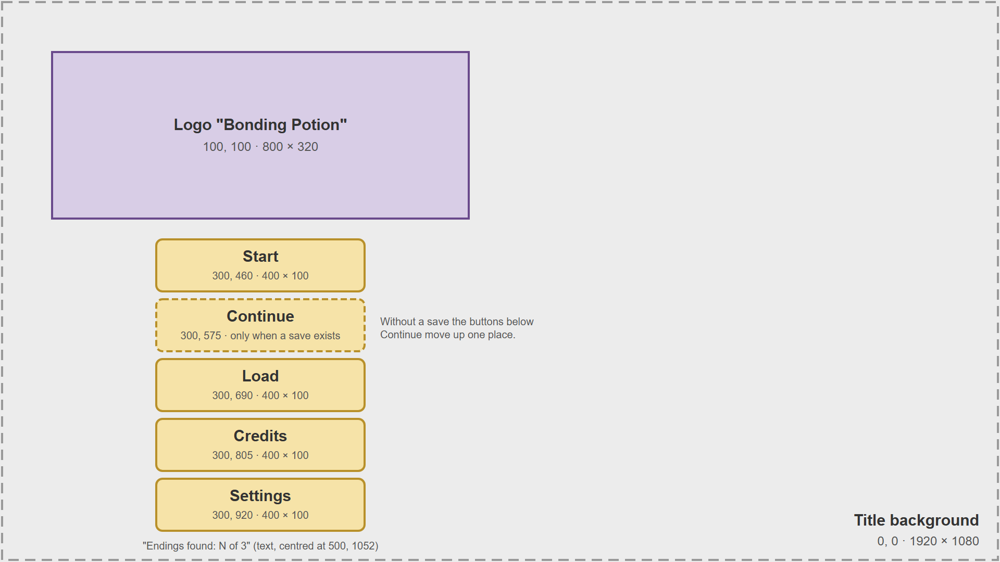
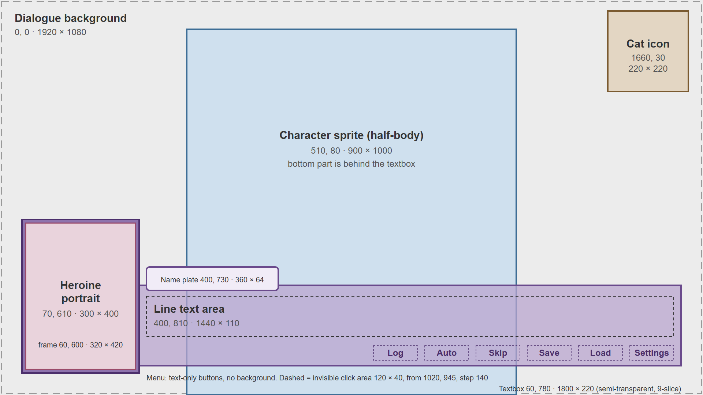
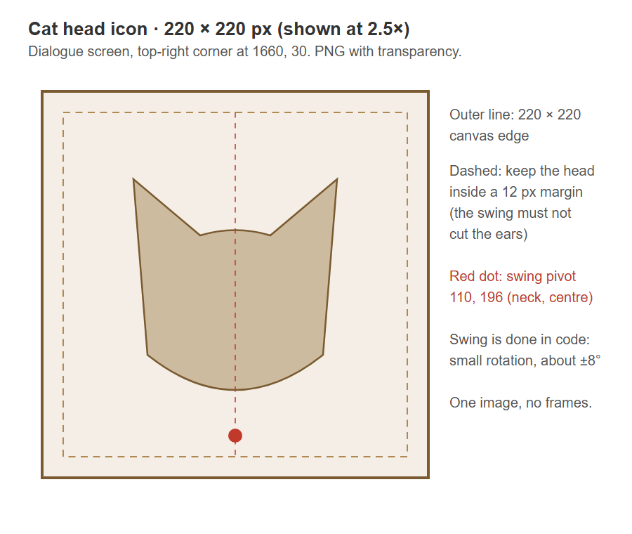
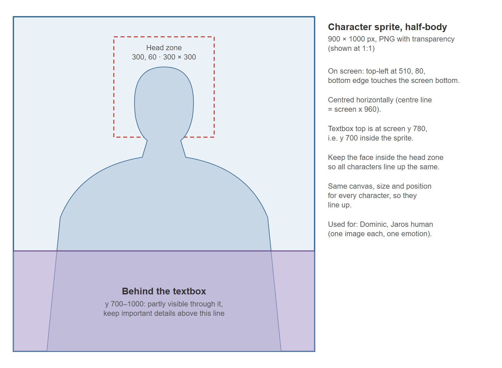
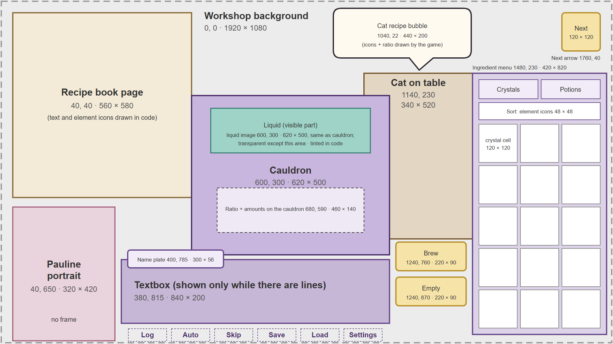

# Bonding Potion — Screen Layouts (rough)

Rough placement and sizes for the artist. Based on the [Game Concept Document](Game%20Concept%20Document.md).

- All screens are **1920 × 1080**. Coordinates are **x, y of the top-left corner**, then **width × height**, in pixels.
- Colours in these drawings only tell the areas apart. They are **not** the game's palette.
- Sprites, portraits, icons and the cauldron are **PNG with transparency**, exported at exactly the listed size.
- Every image is a separate file, so a temporary image in the game can be replaced by a finished one with the same name and size.
- Text, element icons on the recipe page, and counters are drawn by the game; the artist doesn't paint them into the images.

Source files are in [layouts/](layouts/). Each layout has an `.svg` file (exact, scalable) and a `.png` file (preview).

## 1. Main menu

| Element | Position | Size | Notes |
|---|---|---|---|
| Title background | 0, 0 | 1920 × 1080 | One image. The left part sits under the logo and buttons, so keep it calm enough for them to read well. |
| Logo "Bonding Potion" | 100, 100 | 800 × 320 | Left side. |
| Start button | 300, 460 | 400 × 100 | Centred under the logo. Normal, hover and pressed states. |
| Continue button | 300, 575 | 400 × 100 | Only when a save exists. Without it, the buttons below move up one place. |
| Load button | 300, 690 | 400 × 100 | |
| Credits button | 300, 805 | 400 × 100 | |
| Settings button | 300, 920 | 400 × 100 | |
| "Endings found: N of 3" | centred at 500, 1052 | — | Text drawn by the game, once an ending has been seen. |

## 2. Dialogue screen

Drawing order, back to front: background → character sprite → textbox → name plate and menu text → Heroine portrait → cat icon.

| Element | Position | Size | Notes |
|---|---|---|---|
| Dialogue background | 0, 0 | 1920 × 1080 | Shop interior. |
| Character sprite (half-body) | 510, 80 | 900 × 1000 | Centred; bottom edge at the screen bottom. Its lower part is behind the textbox (see section 4). |
| Cat head icon | 1660, 30 | 220 × 220 | Swings slightly while the cat speaks (see section 3). |
| Textbox | 60, 780 | 1800 × 220 | Semi-transparent. Drawn as a stretchable frame (9-slice). |
| Name plate | 400, 730 | 360 × 64 | Speaker's name. Stretchable frame. |
| Line text area | 400, 810 | 1440 × 110 | Text only, no art. |
| Text menu (Log, Auto, Skip, Save, Load, Settings) | first at 1020, 945, then every 140 px to the right | 120 × 40 click area each | Text-only buttons: no background or frame, the player sees and clicks just the words. The click area is invisible. Hover and pressed states are shown by the game (text colour or underline). **No art needed.** |
| Heroine portrait frame | 60, 600 | 320 × 420 | Overlaps the left end of the textbox. |
| Heroine portrait | 70, 610 | 300 × 400 | Inside the frame. 6 expressions, all the same size and framing. |

## 3. Cat head icon

| Property | Value |
|---|---|
| Size | 220 × 220 |
| Position on the dialogue screen | 1660, 30 (top-right corner) |
| Safe margin | Keep the head inside a 12 px margin so the swing doesn't cut off the ears. |
| Swing pivot | 110, 196 (bottom centre, at the neck). The game rotates the icon about ±8° around this point. |
| Frames | One image, no animation frames. |

## 4. Character sprite (half-body)

| Property | Value |
|---|---|
| Canvas | 900 × 1000, the same for every character and expression |
| Position on screen | 510, 80 (centre line at screen x 960) |
| Head zone | 300, 60 · 300 × 300 inside the sprite. Keep the face here so all characters line up. |
| Behind the textbox | y 700–1000 inside the sprite (screen y 780 and below). It shows through the semi-transparent textbox, so keep important details above this line. |
| Used for | Chad (4 expressions), Jaros in human form (3 expressions) |

## 5. Potion-brewing screen

Drawing order, back to front: background → cat → cauldron → everything else.

| Element | Position | Size | Notes |
|---|---|---|---|
| Workshop background | 0, 0 | 1920 × 1080 | Includes the table surface. |
| Recipe book page | 40, 40 | 560 × 580 | Empty page; the game writes the potion name, element icons and text on it. |
| Next arrow | 1760, 40 | 120 × 120 | Normal, hover, pressed and disabled states. |
| Menu (text-only) | 1620, 80 | 120 × 40 click area | Opens the pause panel. No art needed. |
| Cat on the table | 1140, 230 | 340 × 520 | One pose, partly hidden behind the cauldron. Not shown in potion 6. |
| Cauldron | 600, 300 | 620 × 500 | |
| Liquid layer | 660, 340 | 500 × 140 | Light grey; the game tints it to the mix colour. Separate file. |
| Element counter | 700, 620 | 420 × 70 | Drawn by the game on the front of the cauldron, with 64 × 64 element icons. |
| Brew button | 1240, 760 | 220 × 90 | Normal, hover and pressed states. |
| Empty button | 1240, 870 | 220 × 90 | Normal, hover and pressed states. |
| Ingredient menu panel | 1480, 230 | 420 × 820 | Panel background. |
| Menu tabs (Crystals, Potions) | 1500, 250 and 1695, 250 | 185 × 60 each | Normal, hover and selected states. |
| Sort row | 1500, 322 | 380 × 54 | Holds 48 × 48 element icons used as sort buttons. |
| Crystal cells | 3 columns from x 1500, every 130 px; 5 rows from y 390, every 130 px | 120 × 120 each | Crystal art is 128 × 128, shown slightly smaller in the cells. |
| Heroine portrait frame | 40, 650 | 320 × 420 | Same frame as on the dialogue screen. |
| Heroine portrait | 50, 660 | 300 × 400 | Same portrait files as on the dialogue screen. |
| Textbox | 380, 840 | 840 × 200 | Lines of all characters. Same frame style as on the dialogue screen. |
| Name plate | 400, 810 | 300 × 56 | |

## 6. Other screens (no drawing)

| Element | Position | Size | Notes |
|---|---|---|---|
| Ending card: illustration | 0, 0 | 1920 × 1080 | One per ending. |
| Ending card: ending name and "Ending X of 3" | centred, around y 400–600 | — | Text drawn by the game. |
| Ending card: Title button | 760, 880 | 400 × 100 | Same large button as on the title screen. |
| Panel (Pause, Save, Load, Log, Credits, Settings, Confirm) | 360, 140 | 1200 × 800 | Stretchable panel over a dimmed screen. Buttons inside use the small 220 × 90 button. |
| Pause panel buttons | two columns centred at x 800 and 1120; rows at y 340, 460, 580 | 220 × 90 each | Resume, Save, Load / Log, Settings, Title. |
| Save / Load slot cards | 3 × 2 grid from 400, 290; every 390 px across, 270 px down | 340 × 240 each | Drawn by the game (frame, screenshot 288 × 162, slot name, date, scene). No art needed. |
| Save / Load page buttons | right-aligned ending at x 1500, y 185 | 80 × 50 each | Text only: Auto (Load only), 1, 2, 3. |

## 7. Changes to the concept document

Drawing the potion screen at full size showed overlaps in the first numbers. The concept document has been updated to match these layouts:

- Recipe page height: 680 → 580, to make room for the portrait.
- Heroine portrait on the potion screen: same 320 × 420 frame and 300 × 400 portrait as on the dialogue screen.
- Textbox on the potion screen: 380, 840 · 840 × 200, so it ends before the buttons.
- Brew and Empty buttons: stacked at 1240, 760 and 1240, 870.
- Main menu buttons: 400 × 100. The dialogue menu is text-only (120 × 40 click areas) and needs no button art.
